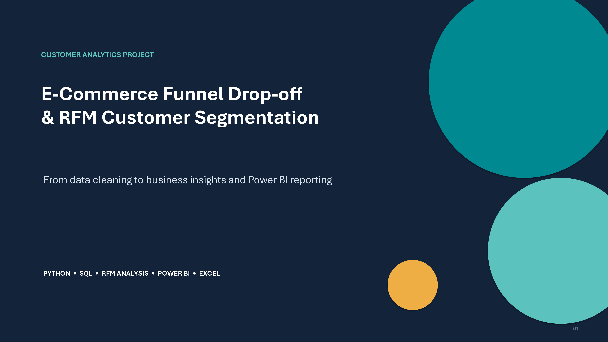

# E-Commerce Funnel Drop-off & RFM Customer Segmentation Analysis



An end-to-end customer behavior analytics project using **Python, Pandas, SQL, and Power BI** to understand purchasing patterns, customer value, repeat-purchase behavior, and customer drop-off.

## Project Overview

This project analyzes a customer shopping behavior dataset containing **3,900 records and 18 columns**. It covers data cleaning, SQL business analysis, RFM segmentation, purchase-frequency and recency drop-off analysis, and an interactive Power BI report.

## Business Objectives

- Understand revenue contribution across customer demographics and product categories.
- Compare subscribers and non-subscribers.
- Identify discount-related purchasing patterns.
- Segment customers by purchase history and RFM behavior.
- Analyze customer drop-off at purchase-frequency and recency thresholds.
- Translate analysis into practical marketing and retention recommendations.

## Tools & Technologies

- **Python:** Data cleaning and feature engineering
- **Pandas:** Data manipulation and analysis
- **PostgreSQL / SQL:** Business queries and customer analysis
- **Power BI:** Dashboarding and reporting
- **Jupyter Notebook:** Exploratory analysis and workflow documentation

## Project Workflow

1. **Data cleaning & preparation**
   - Inspected the dataset with `info()` and `describe()`.
   - Imputed missing review ratings using the median rating within each product category.
   - Standardized column names to snake_case.
   - Created an `age_group` feature.
   - Derived `purchase_frequency_days`.
   - Removed the redundant `promo_code_used` field after checking it against `discount_applied`.
2. **SQL business analysis**
   - Wrote SQL queries to answer 10 business questions.
3. **RFM analysis**
   - Segmented customers based on Recency, Frequency, and Monetary behavior.
4. **Customer drop-off analysis**
   - Examined customer and revenue drop-off by purchase frequency and recency.
5. **Power BI reporting**
   - Built a two-page report covering executive KPIs, category and demographic analysis, RFM segments, customer purchase funnel, and recency behavior.

## SQL Business Questions

The SQL analysis addresses:

1. Revenue by gender.
2. Discount users whose purchase amount is above the average.
3. Top five products by average review rating.
4. Average purchase amount for Standard vs. Express shipping.
5. Average spend and total revenue for subscribers vs. non-subscribers.
6. Products with the highest discount-purchase percentage.
7. New, Returning, and Loyal customer classification based on previous purchases.
8. Top three products purchased within each category.
9. Subscription status among customers with more than five previous purchases.
10. Revenue contribution by age group.

## Dashboard Highlights

The Power BI report includes:

- Executive KPI cards: customers, revenue, average purchase amount, and average review rating.
- Revenue by product category.
- Sales by category.
- Customer breakdown by age group, gender, and subscription status.
- Revenue and spend comparisons by age group.
- RFM segment table and revenue contribution.
- Purchase-depth funnel from 1+ through 40+ purchases.
- Customer recency distribution and retention observations.

### Selected Findings

- **3,900 customers** analyzed.
- **$233,081 total revenue** (approximately $233K).
- **$59.76 average purchase amount**.
- **3.75 average review rating**.
- **27% subscription rate**.
- Loyal Customers contribute approximately **$71K** in revenue in the dashboard.
- The purchase-depth funnel shows **3,563 customers at 5+ purchases** and **847 at 40+ purchases**.

*Figures are based on the analysis and Power BI report included in this repository.*

## Business Recommendations

- Promote subscription benefits to improve subscription adoption.
- Use loyalty rewards to encourage repeat purchases.
- Review discount strategies while monitoring profitability.
- Feature top-rated and best-selling products in campaigns.
- Use targeted marketing based on customer segments and age-group revenue.
- Prioritize retention campaigns for high-value and at-risk customers.

## Repository Structure

```text
.
├── Customer_behaviour_data_cleaning.ipynb
├── RFM Analysis & Drop-off Analysis.ipynb
├── E-commerce Customer Segmentation Analysis.sql
├── Ecommerce_Customer_Behavior_Analysis_Report.docx
├── 01_powerbi_pages.pdf
└── README.md
```

> Update the filenames above if your repository uses different names. Raw/cleaned datasets are not listed here because they may contain data that should not be redistributed.

## How to Explore

1. Open the data-cleaning notebook in Jupyter Notebook.
2. Review the RFM and drop-off analysis notebook.
3. Run the SQL script in PostgreSQL after loading the cleaned data into a table named `customer_data`.
4. Open the Power BI report PDF to review the dashboard pages.

## Skills Demonstrated

`Data Cleaning` · `Exploratory Data Analysis` · `Pandas` · `SQL` · `CTEs` · `Window Functions` · `Customer Segmentation` · `RFM Analysis` · `Retention & Drop-off Analysis` · `Power BI` · `Business Insights`

## Author

**Prince Saini**

- GitHub: [princesaini05](https://github.com/princesaini05)
